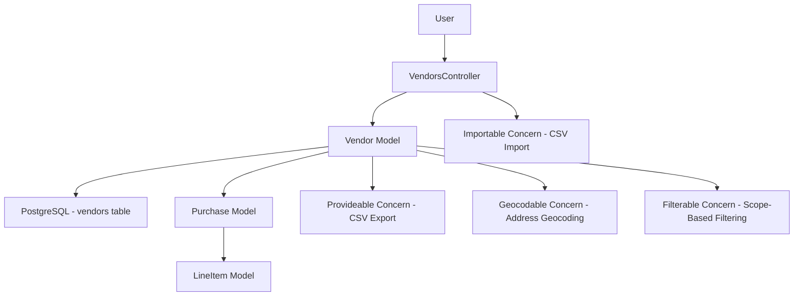
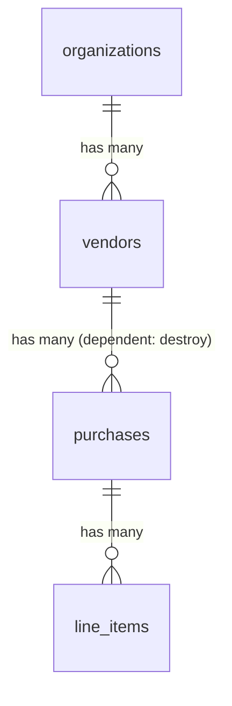
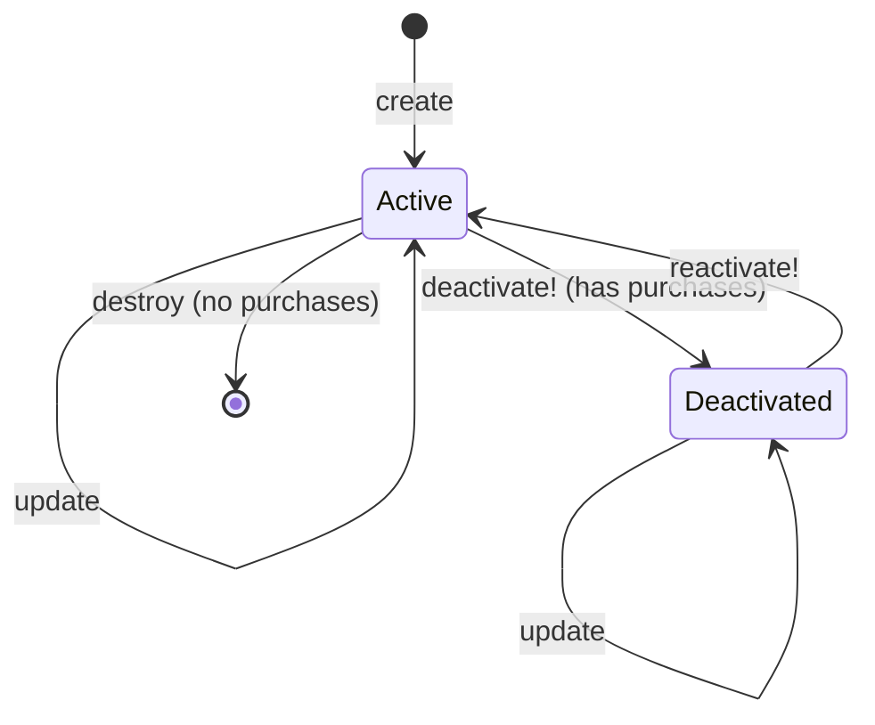

# Vendors

> **Status**: Active
> **Generated**: 2026-06-13T00:00:00Z
> **Last Updated**: 2026-06-13T00:00:00Z

---

## Overview

### What It Does
The Vendors feature manages vendor records -- businesses from which an organization purchases supplies. Each vendor stores contact information and address details, and is linked to purchase transactions. The feature provides full CRUD operations, CSV import/export, soft deactivation (for vendors with purchase history), and hard deletion (for vendors without purchases).

### Why It Exists
Essentials banks need to track which vendors they purchase supplies from. This allows organizations to maintain a directory of suppliers, track purchase volumes per vendor, and generate CSV reports for accounting or auditing purposes.

### Key Capabilities
- Create, read, update, and delete vendor records
- Soft deactivation/reactivation for vendors with existing purchases (prevents data loss)
- Hard deletion for vendors with no purchase history
- CSV import of vendors in bulk
- CSV export of vendor listing with purchase volume totals
- Inline modal creation of vendors from the purchases form
- Geocoding of vendor addresses (via Geocodable concern)
- Purchase volume aggregation per vendor
- Filtering to include/exclude inactive vendors

---

## Architecture

### High-Level Design


### Components

#### Backend Components
| Component | File Path | Purpose |
|-----------|-----------|---------|
| VendorsController | `app/controllers/vendors_controller.rb` | Full CRUD + deactivate/reactivate + CSV import |
| Vendor | `app/models/vendor.rb` | Model with associations, scopes, lifecycle methods |
| Provideable | `app/models/concerns/provideable.rb` | CSV import/export, organization association |
| Geocodable | `app/models/concerns/geocodable.rb` | Address geocoding via `geocoded_by` |
| Filterable | `app/models/concerns/filterable.rb` | Scope-based filtering from controller params |
| Exportable | `app/models/concerns/exportable.rb` | CSV generation infrastructure (included via Provideable) |
| Importable | `app/controllers/concerns/importable.rb` | CSV file upload and parsing for `import_csv` action |

#### Frontend Components
| Component | File Path | Purpose |
|-----------|-----------|---------|
| Index page | `app/views/vendors/index.html.erb` | List vendors with filter, export, import, and action buttons |
| Show page | `app/views/vendors/show.html.erb` | Vendor detail with purchase history table |
| New page | `app/views/vendors/new.html.erb` | Standalone new vendor form |
| Edit page | `app/views/vendors/edit.html.erb` | Edit vendor form |
| Form partial | `app/views/vendors/_form.html.erb` | Shared form (business name, contact, phone, email, address) |
| Vendor row partial | `app/views/vendors/_vendor_row.html.erb` | Table row with conditional delete/deactivate/reactivate buttons |
| New modal partial | `app/views/vendors/_new_modal.html.erb` | Modal dialog for inline vendor creation |
| New modal JS | `app/views/vendors/new_modal.js.erb` | Renders modal into `#modal_new` and shows it |
| Create JS | `app/views/vendors/create.js.erb` | After XHR create: hides modal, updates purchase vendor dropdown |

### Technology Stack
- **Backend**: Ruby on Rails, PaperTrail (versioning), Geocoder gem
- **Frontend**: ERB templates, AdminLTE layout, jQuery (XHR modal), SimpleForm
- **Database**: PostgreSQL

---

## Model Details

### Vendor

#### Associations
```ruby
# Source: app/models/vendor.rb
belongs_to :organization  # via Provideable concern; auto-validates presence (Rails 5+)
has_many :purchases, inverse_of: :vendor, dependent: :destroy
```

#### Concerns
| Concern | Purpose |
|---------|---------|
| `Provideable` | Adds `belongs_to :organization`, `import_csv` class method, `csv_export_headers`, `csv_export_attributes`; includes `Exportable` |
| `Geocodable` | Adds `geocoded_by :address` and `after_validation :geocode` (skipped in development) |
| `Filterable` | Adds `class_filter` class method for scope-based filtering from params |
| `Exportable` | Adds `generate_csv`, `csv_export` class methods (included transitively via Provideable) |

#### Versioning
```ruby
# Source: app/models/vendor.rb:21
has_paper_trail
```

#### Callbacks
| Callback | Method | Purpose |
|----------|--------|---------|
| `after_validation` | `:geocode` | Geocodes address if address is present and changed (skipped in development env) -- via Geocodable |
| `before_destroy` | `:check_for_purchases` | Prevents deletion if vendor has associated purchases; adds error and calls `throw(:abort)` |

#### Validations
```ruby
# Source: app/models/vendor.rb:28
validates :business_name, presence: true
```
The `belongs_to :organization` (from Provideable) also auto-validates presence of `organization_id` (Rails 5+ default).

#### Scopes
```ruby
# Source: app/models/vendor.rb:30-36
scope :alphabetized, -> { order(:business_name) }
scope :active, -> { where(active: true) }
scope :with_volumes, -> {
  left_joins(purchases: :line_items)
    .select("vendors.*, SUM(COALESCE(line_items.quantity, 0)) AS volume")
    .group(:id)
}
```

#### Key Methods
| Method | Returns | Purpose | Notes |
|--------|---------|---------|-------|
| `volume` | `Integer` | Sum of all line item quantities across vendor's purchases | Instance method that queries LineItem directly; duplicates the `with_volumes` scope logic |
| `deactivate!` | `Boolean` | Sets `active` to `false` | Calls `update!` -- raises on failure |
| `reactivate!` | `Boolean` | Sets `active` to `true` | Calls `update!` -- raises on failure |
| `check_for_purchases` | `nil` | Prevents destroy if purchases exist | Private; adds base error and `throw(:abort)` |

#### CSV Export (via Provideable)
```ruby
# Source: app/models/concerns/provideable.rb:21-31
def self.csv_export_headers
  ["Business Name", "Contact Name", "Phone", "Email", "Total Items"]
end

def csv_export_attributes
  [business_name,
   contact_name,
   try(:phone) || "",
   try(:email) || "",
   volume]
end
```

#### CSV Import (via Provideable)
```ruby
# Source: app/models/concerns/provideable.rb:11-18
def self.import_csv(csv, organization)
  csv.each do |row|
    loc = new(row.to_hash)
    loc.organization_id = organization

    loc.save!
  end
  []
end
```

---

## Database Schema

### vendors

| Column | Type | Default | Notes |
|--------|------|---------|-------|
| `id` | `bigint` | auto-increment | Primary key |
| `contact_name` | `string` | `NULL` | Contact person at the vendor |
| `email` | `string` | `NULL` | Vendor email address |
| `phone` | `string` | `NULL` | Vendor phone number |
| `comment` | `string` | `NULL` | Free-text comment field |
| `organization_id` | `integer` | `NULL` | FK to organizations table |
| `address` | `string` | `NULL` | Street address (geocoded) |
| `business_name` | `string` | `NULL` | Required; vendor business name |
| `latitude` | `float` | `NULL` | Geocoded latitude |
| `longitude` | `float` | `NULL` | Geocoded longitude |
| `created_at` | `datetime` | not null | Timestamp |
| `updated_at` | `datetime` | not null | Timestamp |
| `active` | `boolean` | `true` | Soft-delete flag |

#### Indexes
| Index Name | Columns | Unique |
|------------|---------|--------|
| `index_vendors_on_latitude_and_longitude` | `latitude, longitude` | No |

### Relationships


---

## API Endpoints

| Method | Path | Action | Description | Notes |
|--------|------|--------|-------------|-------|
| `GET` | `/vendors` | `index` | List vendors (HTML or CSV) | Filters by active status; supports `include_inactive_vendors` param |
| `GET` | `/vendors/new` | `new` | New vendor form | Supports XHR for modal rendering |
| `POST` | `/vendors` | `create` | Create a vendor | Supports HTML redirect and JS (modal) responses |
| `GET` | `/vendors/:id` | `show` | Show vendor detail with purchase history | Eager-loads purchases |
| `GET` | `/vendors/:id/edit` | `edit` | Edit vendor form | |
| `PATCH/PUT` | `/vendors/:id` | `update` | Update vendor | |
| `DELETE` | `/vendors/:id` | `destroy` | Delete vendor | Blocked by `before_destroy` if purchases exist |
| `PUT` | `/vendors/:id/deactivate` | `deactivate` | Soft-deactivate vendor | Sets `active` to false |
| `PUT` | `/vendors/:id/reactivate` | `reactivate` | Reactivate vendor | Sets `active` to true |
| `POST` | `/vendors/import_csv` | `import_csv` | Bulk import vendors from CSV | Via Importable concern |

### Route Definition
```ruby
# Source: config/routes.rb:179-187
resources :vendors do
  collection do
    post :import_csv
  end
  member do
    put :deactivate
    put :reactivate
  end
end
```

---

## Authorization

The VendorsController inherits from `ApplicationController` but does not use Pundit policy authorization. Access is controlled solely by authentication (user must be signed in) and organization scoping -- all queries are scoped to `current_organization.vendors`, preventing cross-organization access.

---

## Configuration

### Environment Variables
No feature-specific environment variables. Geocoding configuration is handled globally by the Geocoder gem.

### Dependencies
- **PaperTrail** -- version tracking for vendor records
- **Geocoder** -- address-to-coordinates conversion (via Geocodable concern)
- **SimpleForm** -- form rendering in `_form.html.erb`

---

## Usage Examples

### Vendor Row Conditional Actions
The `_vendor_row.html.erb` partial implements conditional action buttons based on vendor state and purchase history:

```erb
<%# Source: app/views/vendors/_vendor_row.html.erb:10-24 %>
<% if vendor_row.active? %>
  <% if vendor_row&.purchases&.none? %>
    <%= delete_button_to vendor_path(vendor_row),
                      text: 'Delete',
                      confirm: confirm_delete_msg(vendor_row.business_name) %>
  <% else %>
    <%= deactivate_button_to deactivate_vendor_path(vendor_row),
                          text: 'Deactivate',
                          confirm: confirm_deactivate_msg(vendor_row.business_name) %>
  <% end %>
<% else %>
  <%= reactivate_button_to reactivate_vendor_path(vendor_row),
                         text: 'Reactivate',
                         confirm: confirm_reactivate_msg(vendor_row.business_name) %>
<% end %>
```

### Inline Modal Creation from Purchases Form
When creating a purchase, a vendor can be created inline via XHR. The `create.js.erb` response updates the purchase form's vendor dropdown:

```erb
<%# Source: app/views/vendors/create.js.erb %>
<% flash.discard %>
$("#modal_new").modal("hide");
$("#purchase_vendor_id").empty();
$("#purchase_vendor_id").
html('<%= j options_from_collection_for_select(current_organization.vendors, :id, :business_name) %>');
$("#purchase_vendor_id").append('<option value="">---Not Listed---</option>');
$("#purchase_vendor_id").val('<%= @vendor[:id] %>');
```

### Controller Index with Volume Aggregation and Filtering
```ruby
# Source: app/controllers/vendors_controller.rb:5-18
def index
  @vendors = current_organization
    .vendors
    .with_volumes
    .alphabetized
    .class_filter(filter_params)

  @vendors = @vendors.active unless params[:include_inactive_vendors]
  @include_inactive_vendors = params[:include_inactive_vendors]

  respond_to do |format|
    format.html
    format.csv { send_data Vendor.generate_csv(@vendors), filename: "Vendors-#{Time.zone.today}.csv" }
  end
end
```

---

## Lifecycle Flow



---

## Testing

### Test Files
- `spec/models/vendor_spec.rb` -- Model validations, scopes, deactivation/reactivation, versioning
- `spec/requests/vendors_requests_spec.rb` -- Request specs for all controller actions (index HTML/CSV, new, edit, show, create, destroy, import_csv)
- `spec/system/vendor_system_spec.rb` -- System/integration tests for full user flows (create, edit, deactivate, reactivate, delete, filtering, purchase volume display)

### Key Test Cases
- Validates `business_name` presence
- `with_volumes` scope correctly aggregates purchase line item quantities
- `deactivate!` sets `active` to false
- `reactivate!` sets `active` to true
- PaperTrail versioning is enabled
- Index page shows only active vendors by default; filter shows inactive
- Delete is blocked when vendor has purchases; succeeds when no purchases
- Vendor row shows Delete button (no purchases) vs Deactivate button (has purchases)
- Show page displays purchases in reverse chronological order by `issued_at`
- CSV import with valid/invalid/missing files
- Inline XHR create from purchase form

---

## Known Issues & Caveats

| Issue | Location | Description |
|-------|----------|-------------|
| Duplicate volume logic | `app/models/vendor.rb:40-44` | The `volume` instance method duplicates the `with_volumes` scope. The scope uses SQL aggregation (`SUM` via `left_joins`), while the instance method queries `LineItem` directly. If `with_volumes` was used to load the vendor, the scope's SQL-computed `volume` attribute shadows the instance method. If loaded without the scope, the instance method runs a separate query. |
| `comment` column not exposed | `app/models/vendor.rb` / `app/controllers/vendors_controller.rb:107` | The `comment` column exists in the schema but is not included in `vendor_params` strong parameters, not shown in any view, and not in the CSV export. It is effectively dead data. |
| No organization FK index | `db/schema.rb:850-864` | The `organization_id` column has no database index, which could slow lookups for organizations with many vendors. |
| `new.html.erb` title says "Edit" | `app/views/vendors/new.html.erb:5` | The `content_for :title` on the new vendor page uses `"Edit - Vendors - ..."` instead of `"New - Vendors - ..."` -- a copy-paste error from `edit.html.erb`. |
| No Pundit authorization | `app/controllers/vendors_controller.rb` | Unlike some other controllers, VendorsController has no `authorize` calls or Pundit policy. Any authenticated user in the organization can perform all vendor operations. |
| `vendor_params` does not permit `comment` | `app/controllers/vendors_controller.rb:107` | Strong params only allow `:contact_name, :phone, :email, :business_name, :address` -- the `comment` field cannot be set through the UI or API. |

---

## Performance

### Database Optimization
- **Index**: `index_vendors_on_latitude_and_longitude` -- composite index on geocoding coordinates
- **Missing index**: No index on `organization_id` (all queries scope by organization)
- **N+1 consideration**: The `show` action uses `includes(:purchases)` to eager-load purchases. The `index` action uses `with_volumes` which performs a single aggregation query via `left_joins`.

---

## Troubleshooting

### Common Issues

#### Issue: Vendor cannot be deleted
**Symptoms:**
- Flash error: "Vendor has purchase items" / "could not be removed"

**Cause:**
The `before_destroy :check_for_purchases` callback prevents deletion when the vendor has associated purchases.

**Solution:**
Use the Deactivate button instead, which sets `active` to false while preserving purchase history. Alternatively, delete all purchases associated with the vendor first (note: `dependent: :destroy` on the association means this would cascade if the destroy callback did not abort).

#### Issue: Vendor address not geocoded
**Symptoms:**
- `latitude` and `longitude` remain NULL after saving

**Cause:**
Geocoding is skipped in development environment (`!Rails.env.development?` guard in Geocodable concern).

**Solution:**
This is expected in development. In production/staging, ensure the Geocoder gem is configured with a valid API provider.

---

## Related Features

- **[Purchases](./purchases.md)** -- Vendors are the source of purchases; each purchase `belongs_to :vendor`
- **[Manufacturers](./manufacturers.md)** -- Similar entity pattern for donation sources (uses same Provideable concern)
- **[Donation Sites](./donation-sites.md)** -- Similar entity pattern for donation drop-off locations

---

**Generated:** 2026-06-13T00:00:00Z
**Last Updated:** 2026-06-13T00:00:00Z
**Status:** Active
